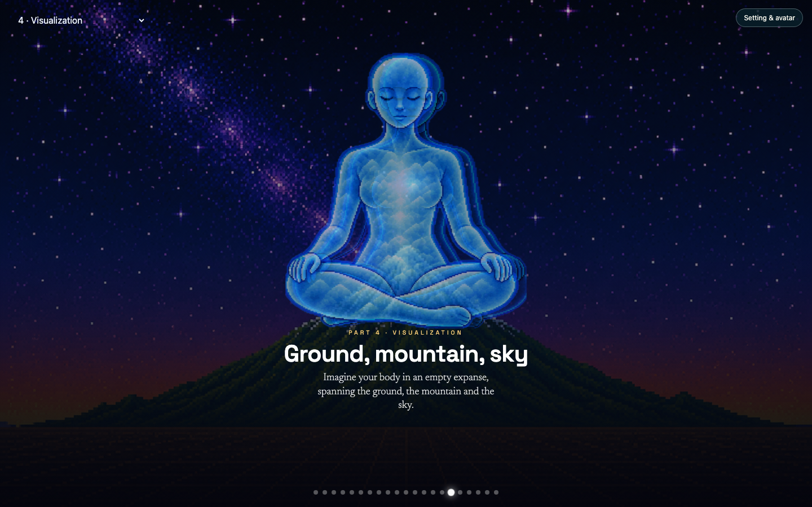
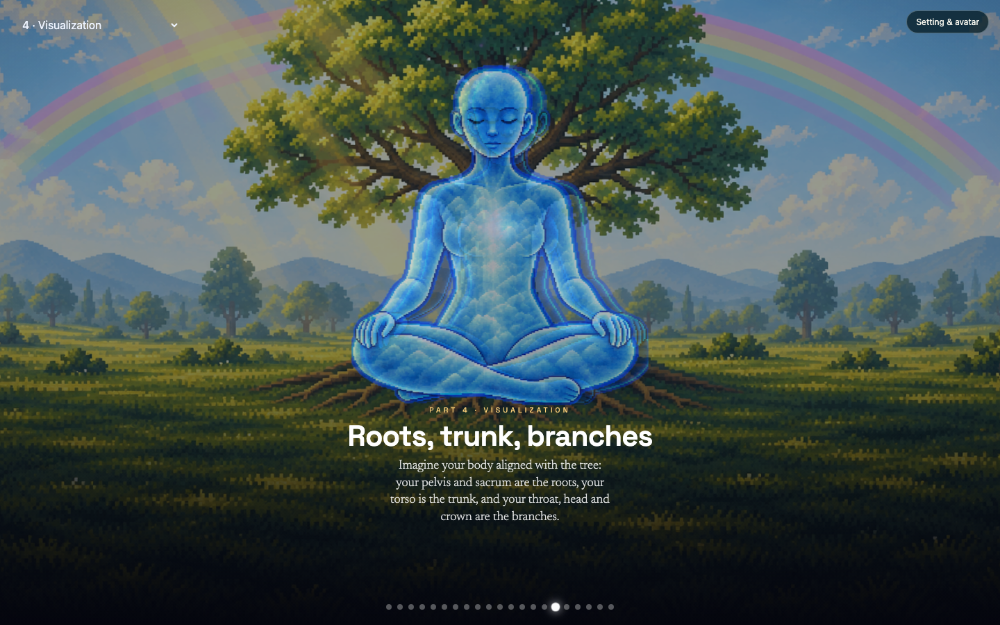
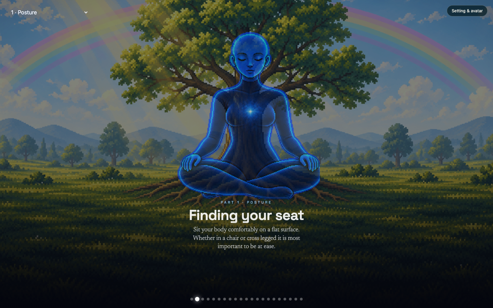
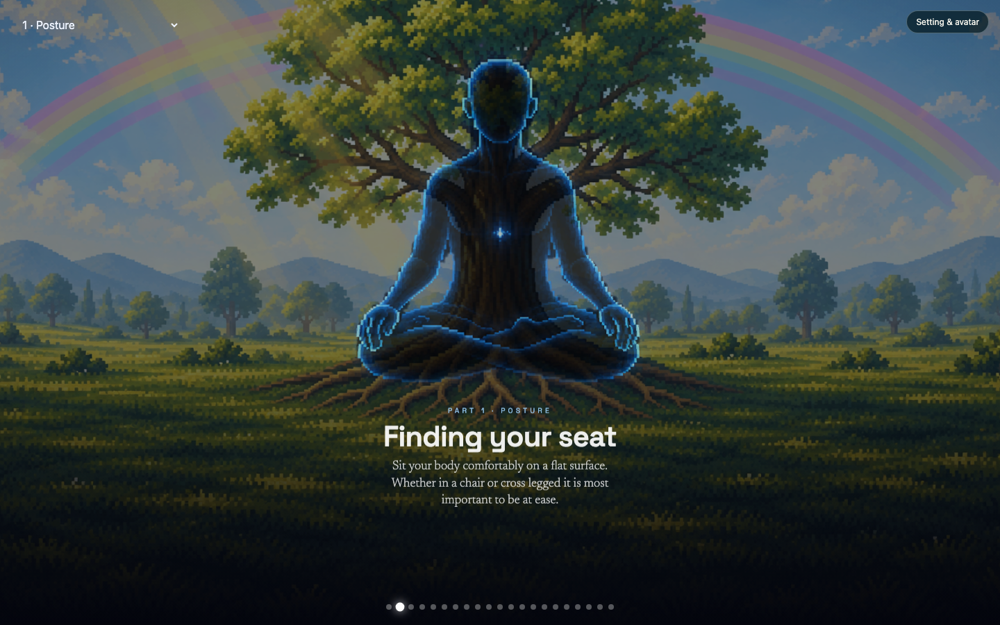
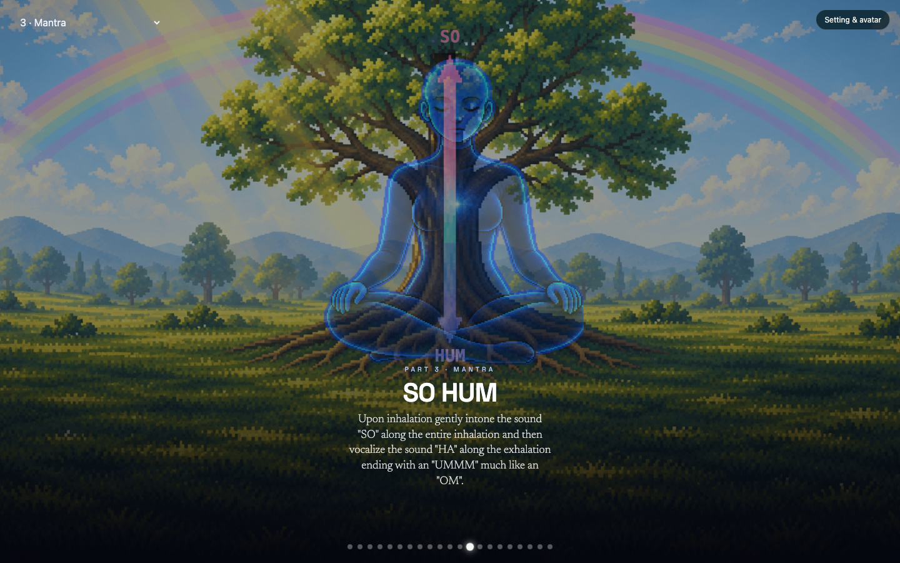
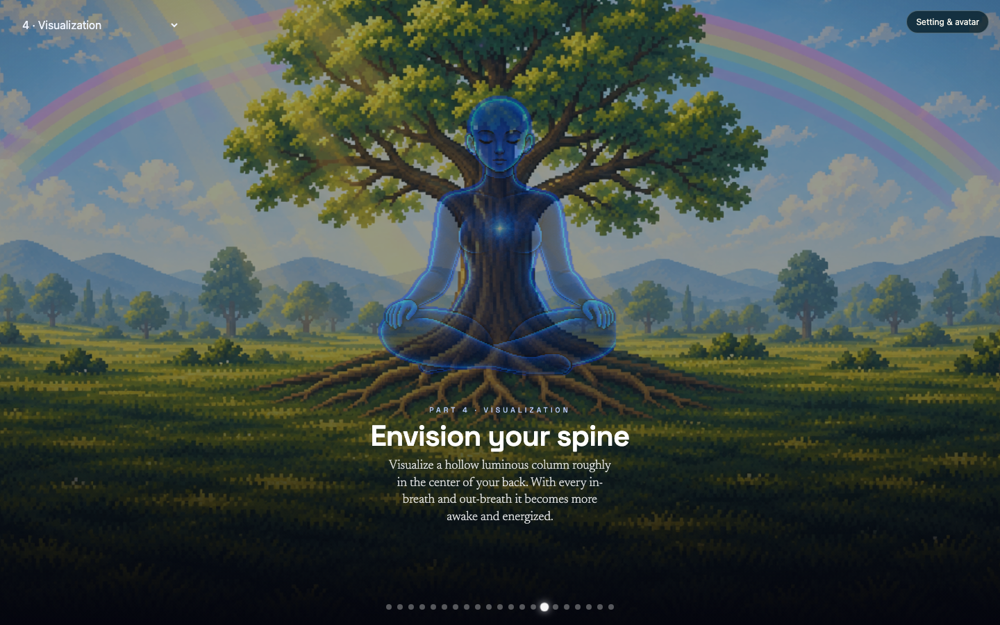
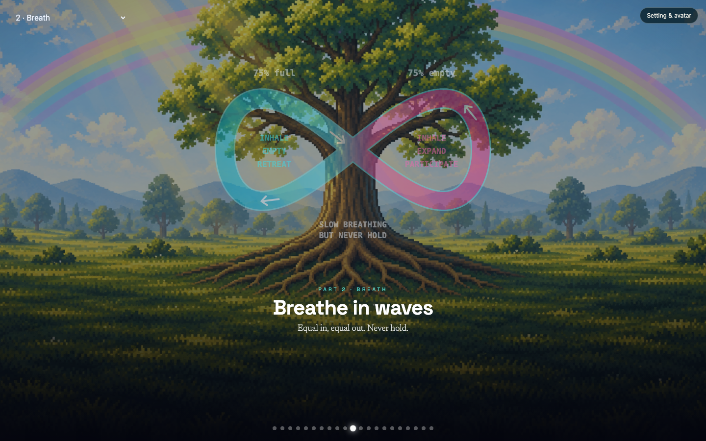
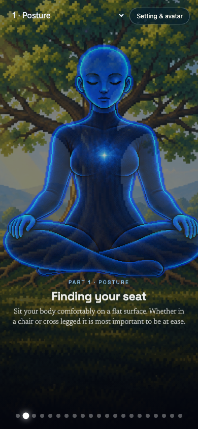
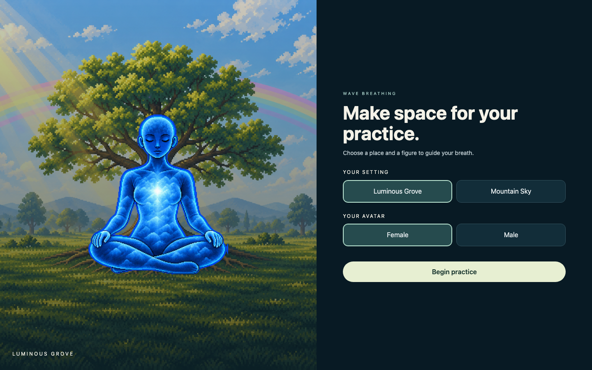
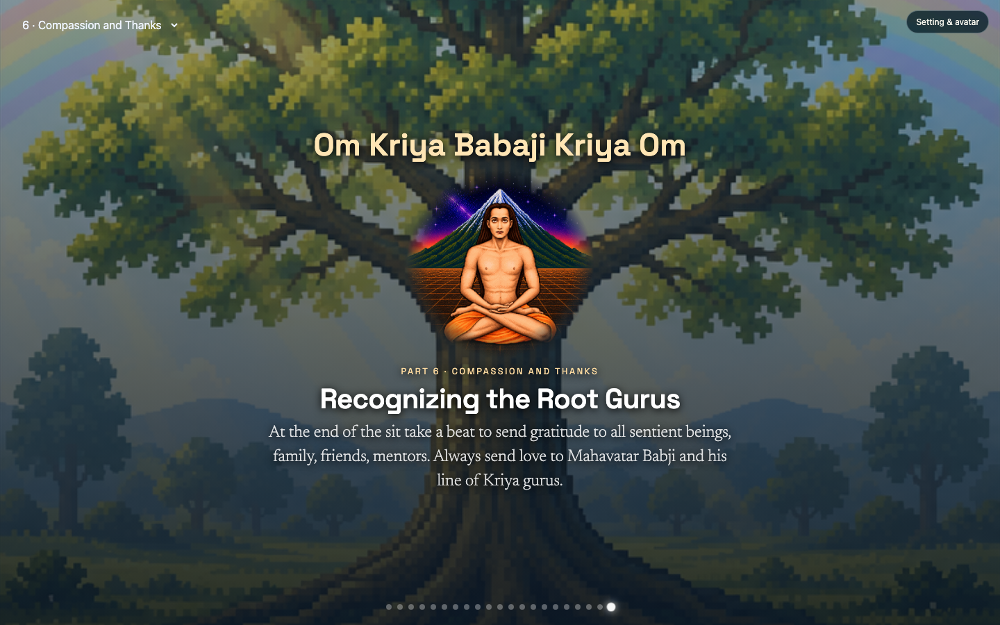

# Wave Breathing audit

Audit date: 2 November 2026. No application code was changed, and nothing was pushed or deployed.

## Baseline

| Item | Value |
| --- | --- |
| Clone | `~/Desktop/kriya1_wb` |
| Origin | `https://github.com/DirtImperial/kriya1_wb.git` |
| Starting branch | `main` |
| Starting commit | `39fc40629af05d7b3f0abe879fc0b8c686458b07` |
| Commit message | Complete aligned figure assets for avatar selection release |
| Commit date | 25 September 2026, 16:08 EDT |
| Working tree at clone | Clean. The folder did not exist before this clone, so nothing local was overwritten. |
| Audit branch | `audit/wave-breathing`, created from that commit and not pushed |
| Local preview | http://127.0.0.1:5173/ |

`DEPLOYMENT.md` still describes a 15 September 2026 publish of commit `a972b5c`. That note is older than the current `main` tip.

## What the app is

Wave Breathing is a static guided practice. Netlify publishes `public/` with no build (`netlify.toml`). The page a visitor gets is `public/index.html`.

A first visit opens a full-screen chooser: Luminous Grove or Mountain Sky, and Female or Male, then **Begin practice**. The practice itself is one 21-step sequence:

| Steps | Part menu | Screens |
| --- | --- | --- |
| 0 | Overview | Wave Breathing |
| 1–8 | 1 · Posture | Finding your seat through Awareness of crown |
| 9–11 | 2 · Breath | The empty vessel, Breathe in waves, Fill & empty |
| 12–13 | 3 · Mantra | Two screens, both titled SO HUM |
| 14–16 | 4 · Visualization | Envision your spine, then the environment scene, then Rest in the expanse |
| 17–19 | 5 · Integration | Bring the four together, Build familiarity, Let it become natural |
| 20 | 6 · Compassion and Thanks | Recognizing the Root Gurus |

The README describes five chapters. The running app has those five plus Compassion and Thanks. `chapter_structure.py` still says the later chapter copy is provisional.

There is no audio, no pause, no speed control, and no saved step. The only saved preference is the chooser, under `localStorage` key `wave-skin`.

## How the files fit together

`public/index.html` is the product. It is a generated DC/React page (the runtime is `public/assets/preview-bundle/b7d63beb-e716-498e-820d-d360601dbf75.js`, duplicated as `public/support.js`, which the live page does not load). The stage list, click and keyboard handlers, and chapter jumps live in the `text/x-dc` script at the bottom of `index.html`, from about line 488.

`public/chooser.js` and `public/chooser.css` are loaded by `index.html` and are not produced by the Python generators. They own the opening screen, the Setting & avatar button, `localStorage`, and the Mountain Sky background swap.

The Python modules describe an earlier generation pipeline:

| File | Role |
| --- | --- |
| `process_figures.py` | Extracts and aligns figure PNGs, then rewrites both `public/index.html` and `public/transparent-preview.html` from `reference/original-netlify-index.html`. |
| `chapter_structure.py` | Inserts the chapter copy, hand-pose CSS, closing page, and part menu. |
| `wave_loop.py` | Builds a figure-eight diagram. The live page no longer matches this output. |
| `mantra_scene.py` | Builds the SO / HUM scenes. |
| `visualization_scene.py` | Builds the aligned landscape scene and can write `public/assets/visualization-landscape.png`. |
| `solar_spiral.py` | Builds the solar-plexus spiral and crown glow. |

`public/index.html` and `public/transparent-preview.html` are identical. `public/figure-review.html` is a separate artwork gallery and is not linked from the practice. The three `public/wave breathing - *.dc.html` files and `reference/` are older variants. `reference/standalone-index.html` is not the production entry, as `AGENTS.md` says.

The generators were not run. Re-running `process_figures.py` would rewrite `public/index.html` from the old Netlify export. That would drop the chooser, the grove layout, the female SVG figures, and the current breath-arrow animation. Treat `public/index.html`, `chooser.js`, and `chooser.css` as the files to edit unless a later project explicitly rebuilds the pipeline.

## How a session behaves

Begin practice hides the chooser, stores the choice, jumps to Finding your seat, and focuses the Part menu (`chooser.js` line 12).

From then on:

- Clicking the page advances one step (`index.html` line 647). ArrowRight and Space do the same, unless focus is on a select, input, or button (lines 533–536). ArrowLeft goes back and stops at the first step.
- The Part menu jumps to the start of a part (line 648). It does not move one step at a time.
- Twenty-one 8px dots sit at the bottom (lines 474–476). They are clickable and have no accessible name.
- “Tap anywhere to begin” is shown only on the overview (lines 471 and 603–604). Begin practice skips that overview, so the hint is hidden for the whole sitting.
- The step after Recognizing the Root Gurus wraps to the overview (`go()` lines 627–630). One more click starts Posture again. There is no end screen.
- Opening Setting & avatar and pressing Begin practice always returns to Finding your seat, even mid-practice.
- Refresh shows the chooser again. The last setting and avatar are preselected, but the practice step is forgotten and the choice is not applied until Begin.

Visible layers are swapped in `applyStage()` by setting opacity. Breath filling is a JavaScript timer (`startVessel()`, line 547) stepping four body frames every 1.5 seconds. The figure-eight arrows are SVG `animateMotion` at 12 seconds. The mantra words and body frames are CSS at 12 seconds. Hand poses cycle over 15 seconds. The seated front/side crossfade is 10 seconds.

## Findings

Severity is about a practitioner’s ability to follow the sitting, not about code style. Each item is marked **Confirmed bug**, **Usability observation**, or **Suggestion**.

### 1. Mountain Sky does not show the alignment the screen describes

**Confirmed bug. High.**

On Mountain Sky, Visualization says the horizon passes through the navel and the mountain peak meets the third eye. The figure instead sits in the sky, well above a small peak.

The grove version places the same figure in the tree, which matches “Roots, trunk, branches” much more closely.

Reproduction:

1. Choose Mountain Sky and Female, then Begin practice.
2. Open the Part menu and choose 4 · Visualization.
3. Advance once, to Ground, mountain, sky.

Cause: `chooser.css` line 2 paints `assets/01-landscape.png` as a CSS cover image and hides the grove SVG. The figure stays in the grove placement box from `index.html` (the `--grove-unit` rules around lines 101–104). That box was not repositioned for the mountain photograph. `visualization_scene.py` knows how to register a landscape to the figure, but the live Mountain Sky path does not use that registration.

### 2. The male figure does not carry the posture lessons

**Confirmed bug. High.**

Female Finding your seat is a luminous seated figure. Male Finding your seat is a dark, hollow body with the tree showing through the torso. Place the hands starts on that same hollow frame.

Reproduction: choose Male, Begin practice, and compare Finding your seat with Female. Then advance to Place the hands.

Cause: `chooser.js` line 11 rewrites female SVG addresses when Male is selected. `female-cloud-0.svg`, which is the front view and the palms-down pose, becomes `figures/breath-0.png` (an empty breath frame). Palms up and hands-in-lap do switch to `hands-up-v1.png` and `hands-lap-v1.png`. A few poses use `seat-chin.png` and `seat-cushions.png`. The aligned male seat set in `public/assets/figures/seat-*.png` is mostly unused. No image request failed; the wrong picture is wired up.

### 3. After Begin, the sitting does not explain what to do next

**Usability observation. High.**

The chooser is clear: a headline, two choices, and Begin practice. That clarity stops at the first posture screen.

What a newcomer does not get:

- A Next control. Advancement is a click anywhere on the page, or the arrow keys.
- The “Tap anywhere to begin” line. Begin skips the overview, and the hint is then set to `display: none`.
- A step count inside the part. The menu says “1 · Posture” for eight different screens. The only position cue is which of 21 dots is brighter.
- A signal that a part, or the sitting, is finished. The last click returns to Wave Breathing and the hint reappears, which reads as a restart rather than a close.

The dots are 8 by 8 pixels (`index.html` line 476), unlabeled, and not in the tab order. On a 320px-wide screen their row is 328px, so the end dots are clipped.

This is the main product gap. The practice can be operated once someone knows the secret, and chapter jumps do work. It does not teach the interaction.

### 4. Changing the setting or avatar throws away the current step

**Confirmed bug. High.**

Reproduction:

1. Begin practice and advance to Shoulders relaxed.
2. Press Setting & avatar.
3. Change the avatar or leave it, then press Begin practice.

The screen returns to Finding your seat. `chooser.js` line 12 sets the Part menu to `1` and fires `change` on every Begin, including a reopen. The preference save itself works.

### 5. The HUM label sits on top of the chapter label

**Confirmed bug. Medium.**

On the first SO HUM screen, the word HUM is at the bottom of the figure and collides with “PART 3 · MANTRA”. SO, at the crown, stays readable. The arrow and the instruction text are otherwise intact.

The label is placed at `y="888"` in the mantra SVG (`mantra_scene.py` lines 39–43; the same markup is in `index.html` around lines 373–410). The practice title block begins at 64% of the screen height and covers that spot.

### 6. The spine screen does not show a distinct column

**Usability observation. Medium.**

Envision your spine asks for a hollow luminous column in the back. At desktop size the screen looks like the normal seated figure. A separate column is not apparent next to Finding your seat.

The markup does draw a vertical stroke over `female-cloud-0.svg` (`process_figures.py` lines 204–208, carried into `index.html`). On this artwork the stroke is lost in the body. Integration then repeats the visualization scene for three more screens, so those steps are also hard to tell apart visually. The words change; the picture mostly does not.

### 7. Breath pictures do not share one clock, and nothing can pause them

**Usability observation. Medium.** There is no separate playback UI. This is the full set of controls: click, arrows, dots, and the Part menu.

| Picture | Clock in the live page |
| --- | --- |
| Figure-eight arrows | 12s SVG motion, three arrows offset by 4s (`index.html`, the `animateMotion` blocks) |
| SO / HUM words and body frames | 12s CSS |
| Fill & empty frames | 9s JavaScript loop, 1.5s per frame (`startVessel`) |
| Hand positions | 15s CSS |
| Front/side seat crossfade | 10s CSS |
| Solar spiral | 4.8s CSS |

Reduced motion is partial. With `prefers-reduced-motion: reduce`, hand poses, the hand glow, the solar spiral, the crown pulse, the seat crossfade, and the moving breath arrows stop. The mantra body frames keep running (`mantra-body-0`, 12s). The mantra text scale does stop. There is no pause button for someone who does not use that system setting.

### 8. The figure-eight adds labels the original diagram does not have, and they are hard to read on the tree

**Usability observation. Medium.** Not classified as a defect until the wording is confirmed.

The supplied diagram (`public/assets/wave-diagram.png`) labels the left loop EXHALATION / CONTRACTION / RETREAT and the right loop INHALATION / EXPANSION / PARTICIPATION, with FADE OUT and FADE IN. It does not say “75% full” or “75% empty”.

The live diagram keeps the exhalation and inhalation groups, drops FADE OUT / FADE IN, and adds “75% full” over the exhalation loop and “75% empty” over the inhalation loop (`index.html` line 435). Those words also sit on the tree without a plate, so they are harder to read than the original black-background art.

### 9. Progress and the opening choice do not survive a refresh in the way a return visit needs

**Usability observation. Medium.**

`wave-skin` remembers avatar and environment. On refresh the chooser is back, those buttons are preselected, and the practice behind it is the overview. The saved choice is not applied until Begin, and Begin always starts Posture. Nothing records the step.

Whether that is a bug depends on the product. It is correct for a single sitting that should always start clean. It is a problem if people are expected to leave and come back.

### 10. Keyboard and assistive tech can operate only part of the page

**Confirmed bug for the items below. Medium for keyboard, high if screen-reader support is in scope.** A full VoiceOver or NVDA pass was not done.

Confirmed:

- After Begin, focus is on the Part menu. ArrowRight and Space then do not advance the practice. They only work after focus leaves that menu. Blurring and pressing ArrowRight does advance (verified: Finding your seat to Lift the hips if tight).
- The dots are `span` elements. They are not tabbable and have no names.
- While the chooser is open, the Part menu underneath is still in the tab order. The chooser has no focus trap and is not marked as a dialog. The page also has no `lang` attribute.
- Ten `role="img"` graphics stay in the accessibility tree while their layers are hidden. Hidden steps are only `opacity: 0`, not `aria-hidden`.
- The overview has no body text, so the runtime logs `[dc-runtime] Root: {{ body }} never resolved — rendered as empty`. That is not shown to the visitor. It happened on load and again when returning to the overview. No JavaScript exception was thrown.

The chooser buttons do expose `aria-pressed`, and the Part menu has `aria-label="Part"`. Focus outlines exist for the chooser and the Part menu.

### 11. Small-screen layout is usable, with a few tight spots

**Usability observation. Low to medium.**

Checked at 1440×900, 768×1024, 390×844, and 320×640.

The chooser stacks under 650px and still fits at 320×640, including Begin practice. Posture on a phone keeps the figure, the title, and the short instruction on screen.

At 320px the Part menu’s layout box intersects the Setting & avatar button. The visible words still have a gap, and the button is painted above the menu, so this is a near miss rather than a broken control. The dot row is slightly wider than the screen. Instruction text did not overflow its box at these sizes, including the longer SO HUM and Integration paragraphs on desktop. A tap anywhere still advances, so if a future edit makes the text scroll, a scroll attempt can also change the step (`user-select: none` is set on the page root, line 323).

Header contrast is uneven. The Part menu has a transparent background. One sample of its white label against the foliage behind Finding your seat was about 4.9:1, just above the usual 4.5:1 text minimum. Brighter sky or leaves will fall below that. Setting & avatar has a dark plate and is safer.

### 12. Wording and document drift

**Observations, not recommended edits until you confirm them.** The practice wording was left untouched.

- “Find a position for your hands there is no right or wrong” has no comma after “hands”.
- The solar-plexus sentence has no final period.
- The closing mantra says Babaji. The paragraph says Babji.
- Both mantra screens are titled SO HUM, so the Part menu and the heading do not show that the second screen is the internalized version.
- A reminder list in the script (“Never fully fill or empty”, and four other lines) is never shown. No stage sets `remember`.
- `DEPLOYMENT.md` describes an older commit. The README’s five-chapter description omits Compassion and Thanks.
- `chapter_structure.py` still points the hand animation at `hands-down-v2.png`. The live female page uses the cloud and pose SVGs.

### 13. Rebuilding from Python would discard the current release

**Confirmed engineering hazard. High if anyone runs the generator. Not a visitor-facing bug today.**

`process_figures.py` line 180 says the production page remains unchanged, then lines 242–243 write both `index.html` and `transparent-preview.html`. The live page has since gained the chooser, grove coordinates, female SVGs, environment-specific sentences, and SVG breath arrows (`wave-flow-frame`, which `wave_loop.py` still emits, appears nowhere in `index.html`). Running the script would publish a different app.

## What is working

- The local static server serves `public/index.html` with no build.
- All local images and fonts referenced by the practice returned successfully. The only failed requests were the unused Google Fonts preconnect hints. Fonts are self-hosted `.woff2` files.
- The chooser is understandable on desktop, tablet, and phone.
- Part jumps land on the right opening screen for all six menu entries, including Compassion and Thanks.
- Female grove posture, the breath diagram, Fill & empty, both mantra screens, grove visualization, and the closing portrait all render.
- Arrow keys move between steps once the Part menu is not focused.
- The saved avatar and environment are restored as the chooser’s selected buttons after refresh.
- Reduced motion stops the hand cycle, crown, spiral, seat crossfade, and moving breath arrows.
- No broken-image icons and no uncaught exceptions during the walk.

## Recommendations

These are options for a scope conversation. They are not agreed work. Ranges assume one developer who already knows this repository, edits the live `public/` files rather than regenerating them, and keeps the current stage order and instruction text except where a question below explicitly changes it. Ranges include implementation and a desktop/phone check. They do not include new illustration unless called out.

### Essential functionality fixes

| Candidate | Outcome | Rough effort | Depends on |
| --- | --- | --- | --- |
| Mountain alignment | The peak and horizon match the sentence already on the screen, using the current mountain art. | 1–2 days | Confirming the anatomical target (third eye / navel) and accepting the current landscape file. |
| Male posture wiring | Male posture and hands use the intended seated artwork instead of the empty breath frame. | 0.5–1.5 days if the existing `seat-*.png` and hand PNGs are acceptable. Several more days if a new male set must match the female cloud style. | An art decision. No new behavior. |
| Keep your place when editing the chooser | Begin practice from a reopen applies the new skin and stays on the current step. The first Begin from a cold load can still start at Posture. | 2–4 hours | None. |
| Move HUM off the chapter line | The mantra labels stay visible at desktop, tablet, and phone. | 0.5–1 day | A quick visual check of the scaled SO word so the fix does not create a new collision. |
| A visible way to continue, and a visible place in the sitting | A Next and Back control, a “step 3 of 8” line, and a real last screen instead of a silent jump to the overview. Wording of the practice stays as it is. | 1–2 days | Deciding whether the overview remains a step, and what the last screen should say. |

Essential total, if the existing male art is accepted and the mountain can be aligned without new painting: about 4–7 days. The male art decision is the main swing factor.

### Optional UI and UX improvements

| Candidate | Outcome | Rough effort | Depends on |
| --- | --- | --- | --- |
| One breath clock and a pause control | Wave, mantra, and Fill & empty share a pace. Pause freezes them. | 1.5–3 days | Choosing the pace. Today the arrows and mantra are 12s and the fill cycle is 9s. |
| Finish reduced motion | The mantra body frames stop with the other loops, on a readable still frame. | 2–4 hours | None. |
| Make the spine readable | The column instruction has a line or glow that is visible on the female and male figures. | 0.5–1.5 days | Whether a thin stroke is enough or the artwork should change. |
| Header and dot usability | Larger dot targets, names for assistive tech, a background behind the Part menu, and no overlap at 320px. | 1–1.5 days | None. |
| Chooser focus and return visits | Focus stays in the chooser until Begin. Optionally skip the chooser when a choice is already saved. | 0.5–1 day | Whether return visits should skip the intro. |
| Hide inactive pictures from assistive tech, set `lang="en"`, remove the empty-body warning | Cleaner reading order. No visual change. | 2–4 hours | None. |
| Diagram label pass | Restore or keep FADE OUT / FADE IN, and decide the fate of “75% full / 75% empty”, with a readable plate. | 0.5–1 day | The wording question below. Do not treat this as permission to rewrite the breath instruction. |

### Larger future features

| Candidate | Outcome | Rough effort | Depends on |
| --- | --- | --- | --- |
| Resume the last step | Refresh or a later visit returns to the same screen, with a way to start over. | 1–2 days | Confirming that progress should persist on this device only. |
| A maintainable source | Stop hand-editing the generated page, or replace the generator so a rebuild cannot wipe the chooser and grove work. Add a small smoke check for stage count, asset URLs, and chapter jumps. | 3–6 days | A decision to invest in the pipeline before more visual features. |
| Guided audio or a breath metronome | Spoken or tonal cues locked to the chosen pace. | 1–2 weeks | Scripts, recordings or a synthesis choice, and licensing. |
| New avatar or environment art | A male figure in the same language as the female clouds, or a mountain plate that is actually registered to the body. | Art-led. Engineering to wire a finished set is the 0.5–1.5 day item above. | Art direction and source files. |
| Accounts, journals, or class progress | Out of this repository’s current shape. | Separate product scope | A backend and a privacy decision. Not required for the practice to function. |

## Questions that change the scope

1. Must Mountain Sky show the peak at the third eye and the horizon at the navel, or is the current floating arrangement acceptable?
2. Should the male figure use the existing darker seat drawings, or does he need new art in the female cloud style?
3. Is this one 21-step sitting, or do people enter Posture, Breath, Mantra, Visualization, and Integration as separate sessions?
4. Should a return visit skip the chooser, resume the last step, or always start at the beginning?
5. When someone opens Setting & avatar during a sitting, should Begin keep the current step?
6. Are “75% full” and “75% empty” intentional? They are not on the original figure-eight.
7. Is “Babji” in the closing paragraph intentional, beside “Babaji” in the mantra line?
8. Is Compassion and Thanks part of the current product? The README still says five chapters.
9. Is there a required breath length in seconds, and do the pictures need to match it?
10. For this phase, is a pause control, audio, or a screen-reader pass required, or are those later?
11. Should fixes land only in `public/index.html`, `chooser.js`, and `chooser.css`, leaving the Python generators untouched?

## What was tested

- Docs read first: `AGENTS.md`, `README.md`, `DEPLOYMENT.md`.
- Local server: `python3 -m http.server 5173 --bind 127.0.0.1 --directory public`.
- All 21 steps walked on 1440×900, 768×1024, 390×844, and 320×640.
- Female/grove and male/mountain checked on the screens that change with those choices.
- Part menu, keyboard, refresh, chooser reopen, reduced motion, console, and asset requests checked.
- Screenshots in `audit-screenshots/`.

There is no project test suite, and none was added. The Python generators were inspected and not executed.

## What was not verified

- VoiceOver, NVDA, or a full contrast audit against every background.
- A physical iPhone or Android device. Phone and tablet results are emulated viewports in Chrome 156.
- The live Netlify site. This audit used the local `public/` folder only.
- Watching every animation for a full 12-second cycle. Clocks were taken from the markup and computed styles, with stills at the start of several scenes.
- The male palms-up and hands-in-lap frames as pictures. Their URLs were confirmed; only the first hand frame was screenshotted.
- Production deploy, form analytics, or anything outside this repository.
